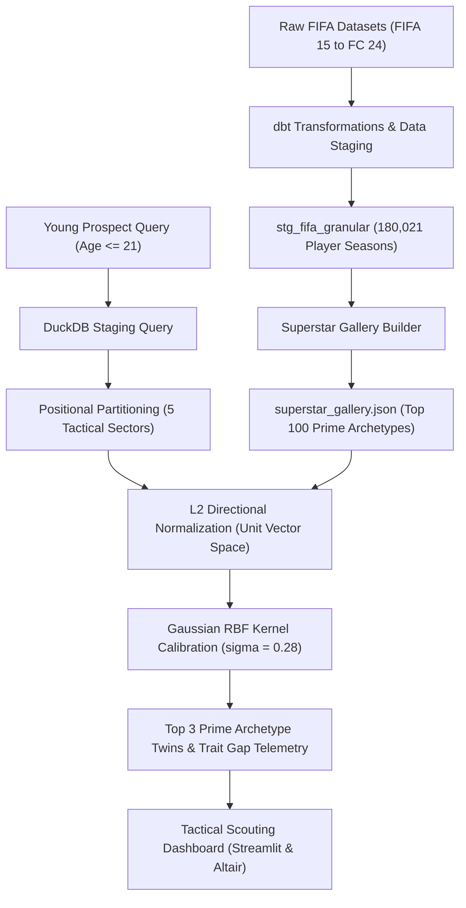

# Analytics FC: Tactical Intelligence and Player Trajectory Platform

Analytics FC is a high-performance sports analytics and scouting intelligence platform. The platform benchmarks young prospects against the historical prime peaks of modern football icons using multidimensional playstyle geometry.

---

## The Problem: Beyond Generic Wonderkid Scouting

Traditional football scouting relies heavily on scalar potential metrics (such as FIFA Potential 88 or Scout Rating A). While scalar metrics indicate that a 19-year-old talent has high potential, they provide zero insight into:
1. **Playstyle Identity:** What specific tactical role and physical archetype does this prospect naturally fit?
2. **Historical Blueprint:** Which world-class superstar followed an identical developmental geometry in their youth?
3. **Developmental Gaps:** Which exact technical and cognitive attributes must improve to reach that superstar ceiling?

Analytics FC answers these questions through **The Superstar Ceiling Matcher** (Flagship Model 1).

---

## System Architecture



---

## Data Foundation and Staging

The platform is backed by a local OLAP DuckDB instance configured for thread-capped, read-only analytical execution:
- **`stg_fifa_granular`**: 180,021 player-seasons covering FIFA 15 through FC 24, with 34 granular technical, physical, and cognitive skill attributes.
- **Top 100 Superstar Gallery (`data/processed/superstar_gallery.json`)**: Curated historical peak profiles of modern football legends evaluated during their prime seasons (ages 26 to 29, peak overall 85 to 94).
- **Tactical Sector Partitioning**:
  - Goalkeepers (5 GK attributes)
  - Defenders (29 outfield attributes)
  - Defensive and Central Midfielders (29 outfield attributes)
  - Attacking Midfielders and Wingers (29 outfield attributes)
  - Center Forwards and Strikers (29 outfield attributes)

---

## Mathematical and Algorithmic Framework

### 1. Directional Normalization (Playstyle Geometry)
Raw attributes for young prospects (age 18 to 21) are systematically lower than mature superstars (age 26 to 29). To eliminate magnitude bias and evaluate pure playstyle shape, attribute vectors are projected onto the unit hypersphere:

$$\mathbf{u} = \frac{\mathbf{v}}{\|\mathbf{v}\|_2}$$

Where $\mathbf{v} \in \mathbb{R}^{29}$ represents the granular skill vector.

### 2. Normalized Euclidean Distance
The playstyle divergence between prospect unit vector $\mathbf{u}_p$ and archetype unit vector $\mathbf{u}_s$ is computed via Euclidean distance:

$$d(\mathbf{u}_p, \mathbf{u}_s) = \|\mathbf{u}_p - \mathbf{u}_s\|_2$$

### 3. Calibrated Similarity Kernel (Gaussian RBF)
To map geometric distance into a calibrated similarity percentage, we apply a Gaussian Radial Basis Function kernel:

$$S(\mathbf{u}_p, \mathbf{u}_s) = \exp\left(-\frac{d(\mathbf{u}_p, \mathbf{u}_s)^2}{2\sigma^2}\right) \times 100$$

With bandwidth parameter $\sigma = 0.28$:
- An identical vector profile scores exactly 100.0%.
- Elite tactical twins typically score between 80.0% and 94.0%.
- Dissimilar tactical styles decay toward 0.0%.

### 4. Trait Gap and Growth Telemetry
For each matched archetype, the engine calculates the attribute delta across all active skill traits:

$$\Delta_i = A_{\text{superstar}, i} - A_{\text{prospect}, i}$$

The system surfaces:
- **Closest Matching Traits:** Attributes where difference is minimal (core natural strengths).
- **Growth Priorities:** Attributes with the largest positive delta (developmental milestones required to fulfill potential).

---

## Performance and Reliability Standards

- **In-Memory Matching Latency:** Less than 15ms across all 100 archetypes.
- **DuckDB Query Performance:** Less than 100ms on indexed analytical lookups.
- **Resource Constraints:** DuckDB strictly throttled to single-thread read-only mode with a 1GB memory cap.
- **Automated Test Coverage:** 17 unit and contract tests in `tests/` validating data schemas, vector mathematics, positional isolation, and negative edge cases.

---

## Quickstart Guide

### Option 1: Local Environment

1. Clone the repository and enter the project folder:
   ```bash
   cd analytics-fc
   ```

2. Create and activate a Python virtual environment:
   ```bash
   python -m venv .venv
   # Windows PowerShell:
   .\.venv\Scripts\Activate.ps1
   # Linux/macOS:
   source .venv/bin/activate
   ```

3. Install required dependencies:
   ```bash
   pip install -r requirements.txt
   ```

4. Run the automated test suite:
   ```bash
   pytest tests -v
   ```

5. Launch the Tactical Scouting Dashboard:
   ```bash
   streamlit run dashboard/app.py
   ```
   Open `http://localhost:8501` in your browser.

---

### Option 2: Docker Container

The platform is packaged in a self-contained, resource-capped Docker container:

1. Build the Docker image:
   ```bash
   docker build -t analytics-fc .
   ```

2. Run the container:
   ```bash
   docker run -p 8501:8501 --memory="1g" --cpus="1.0" analytics-fc
   ```

3. Navigate to `http://localhost:8501` to access the dashboard.

---

## Repository Structure

```text
analytics-fc/
├── dashboard/
│   └── app.py                     # Tactical command Streamlit dashboard
├── data/
│   ├── processed/
│   │   └── superstar_gallery.json # Top 100 prime archetype benchmarks
│   └── raw/                       # Raw source datasets
├── dbt_project/
│   ├── models/                    # Staging and marts SQL transformations
│   └── analytics_fc.duckdb        # DuckDB OLAP database
├── docs/
│   ├── architecture_blueprint.md  # High-level architecture design
│   └── methodology-charter.md     # Mathematical & research charter
├── scripts/
│   ├── build_superstar_gallery.py # Curates Top 100 peak archetypes
│   └── ceiling_matcher.py         # Vector similarity and gap analysis engine
├── tests/
│   ├── test_ceiling_matcher.py    # Unit tests for vector math & routing
│   ├── test_duckdb_contracts.py   # DuckDB safety & schema tests
│   └── test_gallery_integrity.py  # Gallery cardinality & bounds tests
├── Dockerfile                     # Container deployment definition
├── requirements.txt               # Locked project dependencies
└── README.md                      # Platform documentation
```

---

## Verification and Sign-Off

- **Test Suite Status:** 17 of 17 tests passing (`tests/`).
- **Data Integrity:** 100 unique superstar archetypes verified with zero null values across 34 granular attributes.
- **Engine Verification:** Backtested against historical youth profiles (Pedri, Erling Haaland, Kylian Mbappe, Gianluigi Donnarumma).
