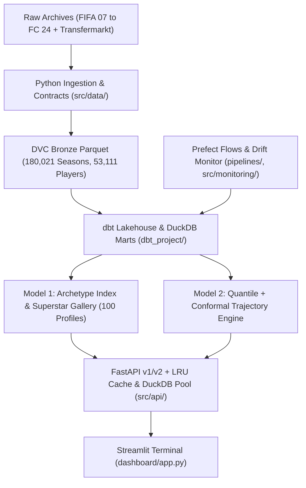

# Analytics FC: Tactical Intelligence and Player Trajectory Platform

Analytics FC is a sports data engineering and machine learning platform for youth player scouting and career trajectory forecasting. It pairs multidimensional playstyle geometry against prime superstar benchmarks (Model 1) with quantile and conformal career growth forecasting (Model 2), backed by a DuckDB and dbt lakehouse, FastAPI v1/v2 serving layers, Prefect pipelines, and a Streamlit terminal.

---

## Core Intelligence Models

Traditional scouting often relies on scalar potential numbers (for example FIFA Potential 88), which hide both **playstyle fit** and **forecast uncertainty**. Analytics FC solves both problems with two production modules:

1. **Superstar Ceiling Matcher (Model 1, `src/models/archetype_indexer.py`, `scripts/ceiling_matcher.py`):** Projects 29 outfield (or 5 goalkeeper) normalized skill vectors onto a unit hypersphere within 5 tactical sectors and ranks 100 personal peak historical archetypes (peak overall 87 to 94) using Euclidean distance and a Gaussian RBF kernel ($\sigma = 0.28$), surfacing attribute growth gaps.
2. **Career Trajectory Forecaster (Model 2, `src/models/`):**
   - `feature_store.py`: Longitudinal lag/lead feature generator producing `78,171` training rows across `22,715` distinct players (`data/processed/trajectory_training.parquet`).
   - `trajectory_regressor.py`: Quantile trajectory regressor (`P10`, `P50`, `P90` growth horizons).
   - `conformal_predictor.py`: Distribution-free conformal uncertainty calibration for trajectory bands.
   - `backtest_suite.py`: Leak-free walk-forward and `GroupKFold` evaluation across `player_id` cohorts.

---

## System Architecture



---

## Data Foundation and Lakehouse (`dbt_project/analytics_fc.duckdb`)

DuckDB runs in thread-capped execution (`threads=1`, `memory_limit='1GB'`), wrapped on the serving path by `DuckDBConnectionPool` and `LRUProfileCache` (`src/api/cache_manager.py`) to avoid Windows file locking conflicts:

- **`raw.granular_15_24` / `main.fct_player_seasons`**: `180,021` player-seasons (FIFA 15 to FC 24) covering `53,111` distinct players in `main.dim_players`.
- **`raw.fifa_granular` / `main.stg_fifa_granular`**: `142,079` historical granular records.
- **`raw.fifatable` / `main.stg_fifatable`**: `43,199` longitudinal wonderkid tracking rows (FIFA 07 to FIFA 21) linked with `raw.tm_stats` (`3,505` rows) and `raw.tm_trophies` (`215` rows).
- **Processed Artifacts (`data/processed/`)**: `superstar_gallery.json` (`100` peak archetypes, peak overall 87 to 94) and `trajectory_training.parquet` (`78,171` trajectory rows across `22,715` distinct players).

---

## Serving APIs (`src/api/`)

Run via Uvicorn on port `8000` (`http://127.0.0.1:8000/docs`):
- **API v1:** `GET /health`, `GET /api/v1/players/search`, `GET /api/v1/players/{player_id}?edition_year=2022`, `GET /api/v1/players/stats/catalog`, `POST /api/v1/match/ceiling`.
- **API v2 (`src/api/v2/router.py`):** `GET /api/v2/health`, `GET /api/v2/players/search`, `POST /api/v2/trajectories/forecast`, `POST /api/v2/archetypes/match`, `GET /api/v2/scout/{player_id}`.
- **In-Memory Cache & Reload Hook (`src/api/cache_manager.py`):** `LRUProfileCache` for warm profile reads, bounded `DuckDBConnectionPool`, and `AtomicArtifactSlot` for zero-downtime artifact swaps.

---

## Quickstart Guide

Execute commands from inside `analytics-fc` using the project virtual environment:

```powershell
cd analytics-fc
$env:PYTHONPATH = "."

# Launch FastAPI v1/v2 Microservice (port 8000)
.\.venv\Scripts\uvicorn.exe src.api.main:app --host 127.0.0.1 --port 8000

# Launch Tactical Scouting Dashboard (port 8501)
.\.venv\Scripts\streamlit.exe run dashboard/app.py --server.port 8501

# Run Master Prefect Pipeline
.\.venv\Scripts\python.exe pipelines/flows.py
```

---

## Quality Checks & Known Environment Notes

```powershell
cd analytics-fc
$env:PYTHONPATH = "."

.\.venv\Scripts\ruff.exe check .
.\.venv\Scripts\ruff.exe format --check .
.\.venv\Scripts\mypy.exe

# Runnable pytest suite (excludes drift tests while pandas 3.1.1 / evidently 0.7.23 mismatch is open)
.\.venv\Scripts\python.exe -m pytest --ignore=tests/test_drift_config.py --ignore=tests/test_drift_analyzer.py -v
```

- **Linter & Static Typing:** `ruff check .`, `ruff format --check .` (`89` files), and `mypy` (`46` source files) pass with zero errors.
- **Evidently / Pandas Compatibility Note:** `.venv` currently runs `pandas 3.1.1` with `evidently 0.7.23`, causing an `ImportError` (`infer_dtype_from_object`) when importing `tests/test_drift_config.py` and `tests/test_drift_analyzer.py`. Ignoring those two files collects `191` tests across the remaining `33` test files.

---

## Repository Structure

```text
analytics-fc/
├── dashboard/                   # Streamlit scouting UI & fallback API client
├── data/                        # DVC descriptors, raw archives, processed parquet/JSON, drift metrics
├── dbt_project/                 # DuckDB database, staging/intermediate/marts SQL, singular tests
├── pipelines/                   # Prefect orchestration flows and hardware-capped task runners
├── scripts/                     # Gallery builder, ceiling matcher, fixture seeding, Trello sync
├── src/
│   ├── api/                     # FastAPI v1/v2 routers, schemas, dependencies, cache_manager.py
│   ├── data/                    # Modern ingestion connector, contracts, entity resolution
│   ├── models/                  # Feature store, Model 1 indexer, Model 2 quantile/conformal/backtest
│   └── monitoring/              # Drift analyzer and monitoring configuration
├── architecture/                # LikeC4 system blueprints and Trello sync checks
├── tests/                       # 35 test modules covering ingestion, dbt, ML, API, CI, and architecture
├── pyproject.toml               # Dependencies, Ruff, and Mypy configuration
└── README.md                    # Platform documentation
```
