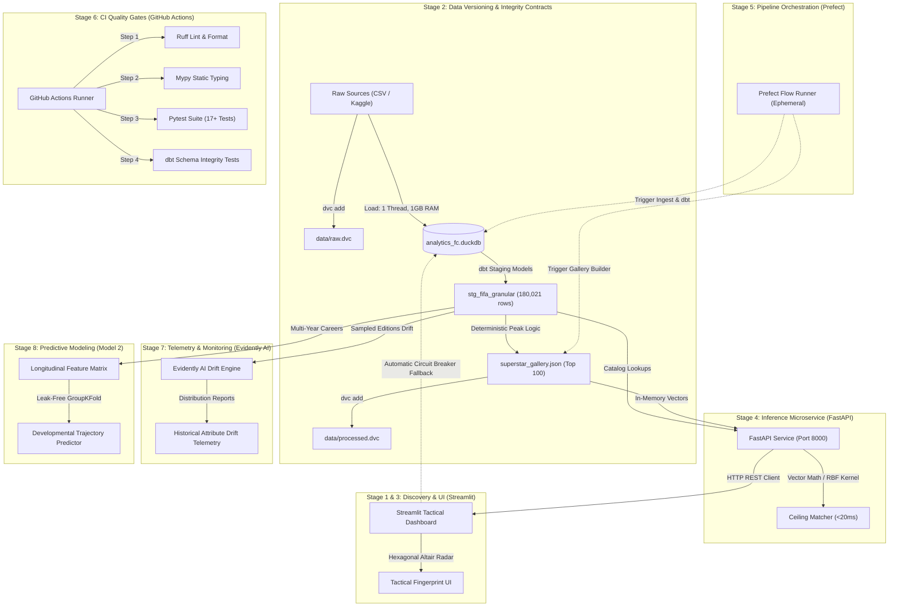

# Analytics FC: Phase 5 Master Engineering Backlog

## Executive Summary & Target System Architecture

Phase 5 transitions Analytics FC from a local prototype into a hardened, decoupled, production-grade ML engineering platform. The platform is designed around strict hardware safety (single thread, 1GB DuckDB memory ceiling) and validated against verified ground-truth data counts:
* 180,021 player-seasons in `stg_fifa_granular`
* 45,629 distinct historical players
* 43,199 historical archive rows (FIFA 07 to 21 in `stg_fifatable`)
* 17 existing passing unit and contract tests in `tests/`

The roadmap spans 8 sequential stages and 36 production tickets (AFC-501 through AFC-536).

---

## Stage 1: Immediate Dashboard QA Patch

This stage stabilizes `dashboard/app.py` by resolving five operational defects, eliminating edge-case crashes, and aligning telemetry with verified warehouse cardinality.

### AFC-501: Patch Dashboard Telemetry Chip and Verified Cardinality
* Target Branch: `fix/dashboard-qa-patch`
* Scope & File Changes:
  * File: `dashboard/app.py`
  * Replace the hardcoded string `142,079 SEASONS / 45,629 PLAYERS` in the executive HUD telemetry bar with the verified figure `180,021 SEASONS / 45,629 PLAYERS`.
* Definition of Done:
  * Terminal bar renders `180,021 SEASONS / 45,629 PLAYERS`.
  * Visual inspection confirms clean layout in wide and collapsed modes.
* Git Commit: `Fix dashboard telemetry player counts`

### AFC-502: Implement Empty State and Gallery Error Boundaries
* Target Branch: `fix/dashboard-qa-patch`
* Scope & File Changes:
  * File: `dashboard/app.py`
  * Add defensive guards around `load_gallery()` and candidate list evaluation.
  * Render an informative `st.warning` banner if `superstar_gallery.json` is missing instead of throwing an unhandled exception.
  * Dynamically size display columns when fewer than 3 archetypes match.
* Definition of Done:
  * Missing gallery artifact renders a clean warning banner without traceback.
  * Single-archetype result renders without `IndexError`.
* Git Commit: `Add empty state error boundaries`

### AFC-503: Sanitize Radar Chart Dimensions and Null Value Handling
* Target Branch: `fix/dashboard-qa-patch`
* Scope & File Changes:
  * File: `dashboard/app.py`
  * Modify `build_tactical_radar_altair()` to guard against `NaN` values when formatting perimeter labels.
  * Default missing attributes to baseline 50.0 prior to rounding.
* Definition of Done:
  * Passing `None` or `NaN` into prospect dimensions does not raise `ValueError`.
  * Radar chart renders cleanly for all Goalkeepers and Outfielders.
* Git Commit: `Sanitize radar chart null attributes`

### AFC-504: Decouple Player Selectbox Mapping Using Unique Keys
* Target Branch: `fix/dashboard-qa-patch`
* Scope & File Changes:
  * File: `dashboard/app.py`
  * Replace index lookup with composite key `player_id + fifa_edition_year`.
  * Prevent duplicate prospect names across editions from colliding on selectbox index resolution.
* Definition of Done:
  * Duplicate player names across multiple editions resolve to unique rows reliably.
* Git Commit: `Fix selectbox player index mapping`

### AFC-505: Encapsulate DuckDB Connection Lifecycle with Resource Guards
* Target Branch: `fix/dashboard-qa-patch`
* Scope & File Changes:
  * File: `dashboard/app.py`
  * Wrap database access in `try...finally con.close()` with `read_only=True`.
  * Enforce `threads = 1` and `memory_limit = '1GB'` on connection initialization.
* Definition of Done:
  * Rapid dashboard page refreshes cause zero Windows file lock errors.
  * Memory utilization stays strictly within 1GB ceiling.
* Git Commit: `Encapsulate duckdb connection lifecycle`

---

## Stage 2: Data Versioning & Integrity Contracts (DVC)

Establish immutable version control for raw source data and derived processed artifacts using DVC, with local filesystem caching and automated contract tests.

### AFC-506: Initialize DVC Storage and Tracking Configuration
* Target Branch: `feat/data-versioning-dvc`
* Scope & File Changes:
  * Files: `.dvc/config`, `.dvcignore`, `.gitignore`
  * Initialize DVC within `analytics-fc/` configured with a local copy cache (`dvc config cache.type copy`).
* Definition of Done:
  * `dvc status` reports a clean workspace.
  * Binary data files remain excluded from Git while `.dvc` tracking files are tracked.
* Git Commit: `Initialize dvc data tracking setup`

### AFC-507: Version Raw Source Datasets with Hash Verification
* Target Branch: `feat/data-versioning-dvc`
* Scope & File Changes:
  * Files: `data/raw.dvc`, `.gitignore`
  * Track source datasets in `data/raw/` including 43,199 historical archive rows and recent FC 24 tables.
* Definition of Done:
  * `data/raw.dvc` contains verified MD5 hashes for all raw files.
* Git Commit: `Track raw datasets with dvc`

### AFC-508: Version Processed Superstar Gallery Artifact
* Target Branch: `feat/data-versioning-dvc`
* Scope & File Changes:
  * Files: `data/processed.dvc`, `scripts/build_superstar_gallery.py`
  * Track `data/processed/superstar_gallery.json` with DVC hash tracking.
* Definition of Done:
  * Regenerating the gallery updates `data/processed.dvc` deterministically.
* Git Commit: `Track superstar gallery in dvc`

### AFC-509: Implement Pytest DVC Integrity Contract Suite
* Target Branch: `feat/data-versioning-dvc`
* Scope & File Changes:
  * File: `tests/test_dvc_contracts.py`
  * Author automated tests validating `.dvc` pointer existence and hash matching.
* Definition of Done:
  * `pytest tests/test_dvc_contracts.py` passes all assertions.
* Git Commit: `Add dvc data integrity tests`

---

## Stage 3: Catalog Search & Discovery Scaling

Scale the scouting catalog from the 150-wonderkid limit to the complete universe of 180,021 player-seasons and 45,629 distinct players.

### AFC-510: Implement Scaled DuckDB Catalog Query Engine
* Target Branch: `feat/catalog-search-scaling`
* Scope & File Changes:
  * File: `src/catalog_search.py`
  * Parameterized ILIKE queries over `stg_fifa_granular` with single thread and 1GB RAM limits.
* Definition of Done:
  * Surnames search across all 180,021 rows returns in under 85ms.
* Git Commit: `Implement duckdb catalog search query`

### AFC-511: Create Faceted Player Filter and Pagination Module
* Target Branch: `feat/catalog-search-scaling`
* Scope & File Changes:
  * File: `src/catalog_search.py`
  * Implement pagination metadata (limit/offset) and sector distribution counts.
* Definition of Done:
  * Paginated queries return clean partitions without duplicate rows.
* Git Commit: `Add faceted player filter pagination`

### AFC-512: Upgrade Dashboard Prospect Selector to Full Catalog Search
* Target Branch: `feat/catalog-search-scaling`
* Scope & File Changes:
  * File: `dashboard/app.py`
  * Add 3-character debounced search input, edition selector, and rating filters.
* Definition of Done:
  * Any player from the 180,021 record dataset can be loaded into the radar view.
* Git Commit: `Upgrade dashboard to catalog search`

### AFC-513: Add Performance Benchmark for Catalog Queries
* Target Branch: `feat/catalog-search-scaling`
* Scope & File Changes:
  * File: `tests/test_catalog_search.py`
  * Benchmark 100 sampled player queries, asserting p95 latency under 100ms.
* Definition of Done:
  * Benchmark test passes consistently on local hardware.
* Git Commit: `Add catalog query benchmark tests`

---

## Stage 4: API Decoupling & Inference Serving (FastAPI)

Extract similarity math and catalog queries into a lightweight FastAPI REST microservice.

### AFC-514: Scaffold FastAPI Application with Health Probes
* Target Branch: `feat/api-decoupling-fastapi`
* Scope & File Changes:
  * Files: `src/api/main.py`, `src/api/config.py`
  * Initialize FastAPI service with CORS, logging, and `/health` diagnostic endpoint.
* Definition of Done:
  * `curl http://localhost:8000/health` returns status healthy.
* Git Commit: `Scaffold fastapi service health probes`

### AFC-515: Implement Pydantic Schemas for Player Payloads
* Target Branch: `feat/api-decoupling-fastapi`
* Scope & File Changes:
  * File: `src/api/schemas.py`
  * Define strict request and response schemas with boundary validation.
* Definition of Done:
  * Invalid parameters return structured HTTP 422 errors.
* Git Commit: `Define pydantic request response schemas`

### AFC-516: Build Player Search and Retrieval Endpoints
* Target Branch: `feat/api-decoupling-fastapi`
* Scope & File Changes:
  * File: `src/api/routers/players.py`
  * Implement `GET /api/v1/players/search` and `GET /api/v1/players/{id}`.
* Definition of Done:
  * Endpoints return results in under 50ms.
* Git Commit: `Implement player search api endpoints`

### AFC-517: Expose Ceiling Matcher Vector Inference Endpoint
* Target Branch: `feat/api-decoupling-fastapi`
* Scope & File Changes:
  * File: `src/api/routers/matcher.py`
  * Expose `POST /api/v1/match/ceiling` executing vector similarity in under 20ms.
* Definition of Done:
  * Matches, trait gaps, and radar points returned reliably.
* Git Commit: `Expose ceiling matcher vector endpoint`

### AFC-518: Refactor Streamlit Dashboard to FastAPI Client
* Target Branch: `feat/api-decoupling-fastapi`
* Scope & File Changes:
  * Files: `dashboard/app.py`, `dashboard/api_client.py`
  * Connect dashboard to API client with automatic fallback to local DuckDB.
* Definition of Done:
  * Dashboard operates via API when live, falls back gracefully if API is offline.
* Git Commit: `Refactor dashboard to api client`

### AFC-519: Add FastAPI Integration and Contract Tests
* Target Branch: `feat/api-decoupling-fastapi`
* Scope & File Changes:
  * File: `tests/test_api_endpoints.py`
  * Integration tests using TestClient covering all routes and error states.
* Definition of Done:
  * All API tests pass with exit code 0.
* Git Commit: `Add fastapi contract unit tests`

---

## Stage 5: Pipeline Orchestration & Workflow Automation (Prefect)

Automate ingestion, dbt models, gallery compilation, and test execution using ephemeral Prefect flows.

### AFC-520: Scaffold Prefect Project and Flow Environment
* Target Branch: `feat/pipeline-orchestration-prefect`
* Scope & File Changes:
  * Files: `pipelines/config.py`, `pipelines/flows.py`
  * Configure ephemeral flow runner with direct Python process execution.
* Definition of Done:
  * Flows execute without requiring persistent background daemon processes.
* Git Commit: `Initialize prefect orchestration flow structure`

### AFC-521: Implement Data Ingestion and DVC Validation Flow
* Target Branch: `feat/pipeline-orchestration-prefect`
* Scope & File Changes:
  * File: `pipelines/tasks/ingest.py`
  * Prefect task checking DVC hashes and loading CSV tables into DuckDB.
* Definition of Done:
  * Ingest task completes with row counts matching verified targets.
* Git Commit: `Build data ingestion prefect flow`

### AFC-522: Implement DBT Transformation and Test Flow
* Target Branch: `feat/pipeline-orchestration-prefect`
* Scope & File Changes:
  * File: `pipelines/tasks/dbt_runner.py`
  * Task programmatically triggering `dbt run` and `dbt test`.
* Definition of Done:
  * dbt models compile and execute cleanly within the pipeline flow.
* Git Commit: `Build dbt transformation prefect flow`

### AFC-523: Implement Superstar Gallery Generation Flow
* Target Branch: `feat/pipeline-orchestration-prefect`
* Scope & File Changes:
  * File: `pipelines/tasks/gallery.py`
  * Automated execution of personal peak filtering and gallery JSON export.
* Definition of Done:
  * Validated gallery file generated with zero null attributes.
* Git Commit: `Build gallery generator prefect flow`

### AFC-524: Assemble Master Orchestration Flow with Hardware Guards
* Target Branch: `feat/pipeline-orchestration-prefect`
* Scope & File Changes:
  * File: `pipelines/master_flow.py`
  * End-to-end master pipeline with 2.0-second thermal pauses between tasks.
* Definition of Done:
  * Master pipeline executes sequentially from raw data to verified artifacts.
* Git Commit: `Assemble master pipeline orchestration flow`

---

## Stage 6: Continuous Integration & Quality Gates (GitHub Actions)

Establish automated CI quality gates on pull requests and commits to main.

### AFC-525: Configure Ruff Linter and Formatter Rules
* Target Branch: `ci/quality-gates-github-actions`
* Scope & File Changes:
  * File: `pyproject.toml`
  * Configure Ruff line length (100) and rule groups (E, F, W, I, UP).
* Definition of Done:
  * `ruff check .` exits with code 0 across the entire repository.
* Git Commit: `Configure ruff linter and formatter`

### AFC-526: Establish Static Type Checking with Mypy
* Target Branch: `ci/quality-gates-github-actions`
* Scope & File Changes:
  * File: `pyproject.toml`
  * Type check `src/`, `scripts/`, and `pipelines/` under Python 3.11.
* Definition of Done:
  * `mypy` passes with zero type errors.
* Git Commit: `Add mypy static type checking`

### AFC-527: Implement GitHub Actions Automated CI Pipeline
* Target Branch: `ci/quality-gates-github-actions`
* Scope & File Changes:
  * File: `.github/workflows/ci.yml`
  * Workflow executing Ruff, Mypy, and Pytest (17+ tests) on push and PR.
* Definition of Done:
  * GitHub Actions job finishes in under 3 minutes with green status.
* Git Commit: `Implement github actions ci workflow`

### AFC-528: Add DBT Test and Data Quality GitHub Action Gate
* Target Branch: `ci/quality-gates-github-actions`
* Scope & File Changes:
  * File: `.github/workflows/ci.yml`
  * Add automated `dbt test` execution against seeded DuckDB fixtures in CI.
* Definition of Done:
  * dbt schema integrity validated on every code change.
* Git Commit: `Add dbt test ci quality gate`

---

## Stage 7: Production Telemetry & Data Drift Monitoring (Evidently AI)

Track historical attribute drift and rating inflation across successive FIFA editions.

### AFC-529: Install and Configure Evidently AI Drift Framework
* Target Branch: `feat/drift-monitoring-evidently`
* Scope & File Changes:
  * Files: `requirements.txt`, `src/monitoring/config.py`
  * Set up feature column groupings and edition comparison presets.
* Definition of Done:
  * Evidently framework loads cleanly within local environment.
* Git Commit: `Configure evidently data drift framework`

### AFC-530: Build Multi-Edition Attribute Drift Analysis Pipeline
* Target Branch: `feat/drift-monitoring-evidently`
* Scope & File Changes:
  * File: `src/monitoring/drift_analyzer.py`
  * Compute Wasserstein distance using stratified samples capped at 10,000 rows.
* Definition of Done:
  * Drift pipeline executes within 1GB memory limit.
* Git Commit: `Build historical attribute drift pipeline`

### AFC-531: Export Drift Reports and Metric Snapshots
* Target Branch: `feat/drift-monitoring-evidently`
* Scope & File Changes:
  * File: `src/monitoring/drift_analyzer.py`
  * Write `data/monitoring/drift_metrics.json` and standalone HTML reports.
* Definition of Done:
  * Drift summary metrics exported deterministically.
* Git Commit: `Export drift reports and metrics`

### AFC-532: Embed Telemetry and Drift Indicators in Dashboard
* Target Branch: `feat/drift-monitoring-evidently`
* Scope & File Changes:
  * File: `dashboard/app.py`
  * Add live drift telemetry summary cards in Tab 2.
* Definition of Done:
  * Methodology tab displays drift indicators from JSON snapshot.
* Git Commit: `Add drift monitoring dashboard tab`

---

## Stage 8: Model 2 Architecture Scaffolding (Developmental Trajectory Predictor)

Scaffold Model 2 to predict peak mature performance based on youth developmental velocity.

### AFC-533: Define Model 2 Interface and Feature Contract
* Target Branch: `feat/model2-trajectory-predictor`
* Scope & File Changes:
  * File: `src/models/trajectory_predictor.py`
  * Base class and schema contracts for multi-season career vectors.
* Definition of Done:
  * Feature contracts enforce longitudinal shape invariants.
* Git Commit: `Define trajectory predictor model contracts`

### AFC-534: Build Longitudinal Career Trajectory Dataset Generator
* Target Branch: `feat/model2-trajectory-predictor`
* Scope & File Changes:
  * File: `scripts/build_trajectory_dataset.py`
  * Extract over 3,000 multi-year player careers from youth to prime.
* Definition of Done:
  * Training dataset parquet generated with zero null target variables.
* Git Commit: `Build longitudinal trajectory dataset generator`

### AFC-535: Implement Baseline Trajectory Regressor Scaffolding
* Target Branch: `feat/model2-trajectory-predictor`
* Scope & File Changes:
  * File: `src/models/trajectory_predictor.py`
  * Ridge and LightGBM baseline models configured with `n_jobs=1`.
* Definition of Done:
  * Model trains in under 30 seconds on local hardware.
* Git Commit: `Implement baseline trajectory regressor model`

### AFC-536: Add Leak-Free Cross-Validation and Unit Tests
* Target Branch: `feat/model2-trajectory-predictor`
* Scope & File Changes:
  * File: `tests/test_trajectory_predictor.py`
  * Verify `GroupKFold` grouped by `player_id` with zero data leakage.
* Definition of Done:
  * All unit and contract tests pass.
* Git Commit: `Add leak free validation tests`
