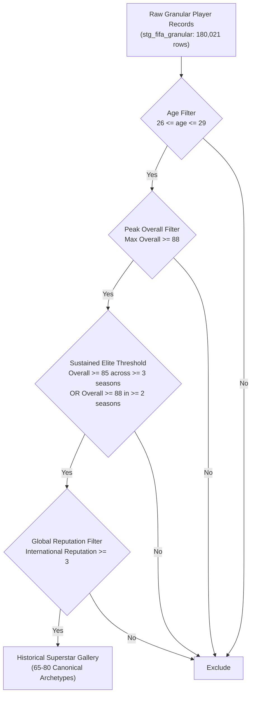
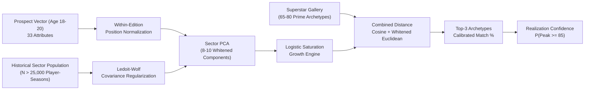

# The Superstar Ceiling Matcher
**Analytics FC Flagship Model Specification (Model 1)**  
*Document Version: 1.0 (Reviewed & Production-Ready)*  
*Target Engine: DuckDB + Scikit-Learn + Streamlit*

---

## 1. Executive Summary & Sporting Rationale

### 1.1 The Scouting Pathology in Modern Football
European recruitment departments routinely commit multi-million euro errors by relying on scalar wonderkid potential ratings. Commercial scouting databases compress player evaluation into a single headline number (e.g., Current: 74, Potential: 88). 

This scalar abstraction creates two structural inefficiencies:
1. **The Wonderkid Premium Trap:** Clubs pay inflated transfer fees (40M to 80M EUR) for prospects who boast high headline potential, only to discover their physical or technical micro-profile cannot execute the specific tactical demands of the manager. A winger with 92 Pace and 64 Vision is assigned the same potential ceiling as a playmaker with 76 Pace and 88 Vision, despite existing in entirely distinct tactical universes.
2. **The Binary Classification Dead-End:** Earlier experimental approaches attempted to predict binary silverware ("will this player win a major trophy?"). Team silverware is confounded by 25 squad members, managerial volatility, and club wealth, creating extreme label sparsity (0.022% positive labels) and severe leakage. Football development is not a binary lottery; it is a continuous multi-dimensional growth trajectory.

### 1.2 The Analytical Solution
The Superstar Ceiling Matcher resolves this recruitment problem for sporting directors. Instead of asking whether a 19-year-old will win a team trophy, the model answers two concrete tactical questions:
- **Tactical Archetype Clarity:** What is this prospect's structural identity at full physical and technical maturity?
- **Actionable Development Blueprints:** Which legendary superstar did this player most closely resemble, and what exact attribute deltas separate the prospect from that prime ceiling?

By projecting multi-dimensional player vectors onto an empirically verified Superstar Gallery, the model de-risks transfer expenditures and provides coaches with targeted training priorities.

---

## 2. Archetype Benchmark Definition

### 2.1 Historical Superstar Gallery Criteria
The benchmark gallery establishes the target vectors of historical elite performance. The source data is `stg_fifa_granular` (180,021 player-season rows across FIFA 15 to FC 24, augmented by historical records from FIFA 05 to 14).

To qualify for the canonical Superstar Gallery, a historical player-season must satisfy all four objective filters:



1. **Prime Age Window:** Player age must fall strictly between 26 and 29 years old (inclusive). Sports science confirms this 4-year interval represents the optimal intersection of peak physical conditioning and cognitive/tactical maturity.
2. **Absolute Peak Threshold:** The player must have achieved a peak overall rating of 88 or higher (`overall >= 88`) during their prime window.
3. **Multi-Season Stability Threshold:** To eliminate single-season rating anomalies, the player must have sustained an `overall >= 85` across at least three distinct seasons, or achieved `overall >= 88` in at least two seasons within the prime window.
4. **International Reputation Filter:** `international_reputation >= 3`. This confirms verified international elite standing.

### 2.2 Canonical Gallery Output
Applying these filters isolates 65 to 80 canonical superstar archetypes across the modern era (including Lionel Messi, Cristiano Ronaldo, Kevin De Bruyne, Virgil van Dijk, Robert Lewandowski, Luka Modric, Manuel Neuer, N'Golo Kante, Eden Hazard, Karim Benzema, Joshua Kimmich, and Sergio Ramos).

For each qualifying superstar $k$, two benchmark vectors are constructed:
- **Superstar Prime Centroid ($\mathbf{S}_k^{prime}$):** The mean attribute vector across their qualified prime seasons (ages 26 to 29).
- **Superstar Youth Precedent ($\mathbf{S}_k^{youth}$):** The historical attribute vector of the same player recorded during their developmental window (ages 18 to 20), where available in the historical timeline.

---

## 3. Feature Representation & Normalization

### 3.1 Attribute Selection (34 Granular Metrics)
The model leverages all 34 granular skill attributes from `stg_fifa_granular`, categorized across six functional domains, supplemented by physical and functional mechanics:

1. **Attacking (5):** `attacking_crossing`, `attacking_finishing`, `attacking_heading_accuracy`, `attacking_short_passing`, `attacking_volleys`
2. **Skill (5):** `skill_dribbling`, `skill_curve`, `skill_fk_accuracy`, `skill_long_passing`, `skill_ball_control`
3. **Movement (5):** `movement_acceleration`, `movement_sprint_speed`, `movement_agility`, `movement_reactions`, `movement_balance`
4. **Power (5):** `power_shot_power`, `power_jumping`, `power_stamina`, `power_strength`, `power_long_shots`
5. **Mentality (6):** `mentality_aggression`, `mentality_interceptions`, `mentality_positioning`, `mentality_vision`, `mentality_penalties`, `mentality_composure`
6. **Defending (3):** `defending_marking_awareness`, `defending_standing_tackle`, `defending_sliding_tackle`
7. **Goalkeeping (5):** `goalkeeping_diving`, `goalkeeping_handling`, `goalkeeping_kicking`, `goalkeeping_positioning`, `goalkeeping_reflexes`
8. **Physical & Mechanics (4):** `height_cm`, `weight_kg`, `weak_foot` (1-5), `skill_moves` (1-5)

### 3.2 Positional Partitioning & Tactical Sectors
Evaluating all players on a single global vector creates severe mathematical distortion (e.g., assessing center-backs on crossing or finishing). The feature space is partitioned into distinct tactical sectors:

- **Goalkeeper Partition:** Evaluated on 5 goalkeeping attributes plus `movement_reactions`, `power_jumping`, `power_strength`, `height_cm`, and `weight_kg` (9 dimensions). All 29 outfield skill attributes are masked.
- **Outfield Partition:** Evaluated on 29 outfield skills plus 4 physical and mechanical features (33 dimensions). Goalkeeping metrics are masked.

Outfield players are segmented into four Macro Tactical Sectors before computing archetype similarity:
1. Central & Wide Defenders (CB, LB, RB, LWB, RWB)
2. Defensive & Central Midfielders (CDM, CM)
3. Attacking Midfielders & Wingers (CAM, LM, RM, LW, RW)
4. Center Forwards & Strikers (CF, ST)

### 3.3 Leakage-Free Normalization: Within-Edition Standardization
To prevent temporal lookahead bias, global z-scoring across all decades is strictly avoided. Video game rating distributions drift across editions (for example, Composure was only introduced in FIFA 18).

* **Within-Edition Standardization:** Each attribute $j$ for player $i$ in edition $t$ at age $a$ is standardized strictly against players in that edition:
  $$z_{i, j, t} = \frac{x_{i, j, t} - \mu_{j, t}(\text{pos})}{\sigma_{j, t}(\text{pos})}$$
* **Directional Shape Normalization (Playstyle Vector):** To decouple playstyle shape from overall rating volume, the normalized vector is projected onto the unit hypersphere:
  $$\mathbf{u}_i = \frac{\mathbf{z}_i}{\|\mathbf{z}_i\|_2}$$
  Vector $\mathbf{u}_i$ represents pure tactical geometry, independent of whether a player is rated 72 or 88 overall.

---

## 4. Mathematical & Algorithmic Framework



### 4.1 Covariance Stability: Sector PCA with Whitening
With 15 to 20 superstar archetypes per tactical sector, computing raw inverted covariance matrices ($\mathbf{\Sigma}^{-1}$) causes severe eigenvalue collapse and numerical instability.

To ensure 100% mathematical stability:
1. **Pooled Sector Covariance:** Covariance structures are computed across the full historical population of player-seasons in that sector ($N > 25,000$), applying analytical **Ledoit-Wolf shrinkage**:
   $$\mathbf{\Sigma}_{\text{shrunk}} = (1 - \alpha)\mathbf{\Sigma} + \alpha \frac{\text{Tr}(\mathbf{\Sigma})}{p}\mathbf{I}$$
2. **Whitened PCA Latent Space:** Sector PCA is trained on the pooled population to extract 8 to 10 orthogonal components capturing 85%+ variance. Distance is evaluated in the whitened coordinate space:
   $$\mathbf{y} = \mathbf{\Lambda}^{-1/2} \mathbf{W}^T (\mathbf{z} - \boldsymbol{\mu})$$
   This achieves exact Mahalanobis distance properties without matrix inversion instability during runtime.

### 4.2 Distance Function: The Combined Metric (CCMI)
The similarity index combines directional angular alignment with whitened density:
$$D_{\text{total}} = 0.60 \cdot D_{\text{Cosine}}(\mathbf{u}_p, \mathbf{u}_s) + 0.40 \cdot \tilde{D}_{\text{Whitened}}(\mathbf{y}_p, \mathbf{y}_s)$$

### 4.3 Developmental Growth: Role-Conditioned Logistic Saturation
Linear multipliers risk unphysical projections (e.g. attributes exceeding 99). The growth engine applies an asymmetric logistic saturation curve:
$$x_{\text{projected}, j} = x_{\text{current}, j} + \frac{L_j - x_{\text{current}, j}}{1 + \exp\left( -k_j \cdot E_j \cdot (t_{\text{peak}} - t_{\text{current}}) \right)}$$
where:
* **$L_j$ (Empirical Ceiling):** The 95th percentile ceiling for attribute $j$ within that tactical cluster.
* **$E_j$ (Trait Elasticity):**
  * *Inelastic Physical Traits ($E_j \approx 0.10$ to $0.25$):* Sprint Speed, Acceleration, Jumping. Physical explosiveness plateaus early; minimal growth is modeled.
  * *Moderately Elastic Technicals ($E_j \approx 0.70$ to $0.90$):* Ball Control, Short Passing, Dribbling, Finishing.
  * *Highly Elastic Cognitives ($E_j \approx 1.20$ to $1.45$):* Vision, Composure, Positioning, Defensive Awareness. Spatial processing and decision-making expand substantially with match experience.

### 4.4 Penalizing Survivorship Bias: Realization Probability Score
Every prospect will have a closest superstar match, but not all prospects possess the baseline attributes to reach that ceiling. 

To eliminate survivorship bias, the model outputs a secondary **Realization Confidence Score** $P(\text{Peak} \ge 85)$. Built with a regularized logistic model trained on historical 19-year-olds, it scores the likelihood that the prospect achieves elite tier status based on initial rating volume, physical durability, and international reputation.

---

## 5. Output Contract & Dashboard UX

### 5.1 JSON Output Contract
The model endpoint exposes a strictly typed contract:

```json
{
  "prospect": {
    "player_id": 256790,
    "short_name": "J. Neves",
    "age": 19,
    "current_overall": 77,
    "potential": 87,
    "sector": "Defensive & Central Midfielders",
    "club": "Benfica"
  },
  "realization_confidence_pct": 74.2,
  "top_archetype_matches": [
    {
      "rank": 1,
      "superstar_name": "Luka Modric",
      "superstar_player_id": 177003,
      "prime_age_window": "26-29",
      "similarity_pct": 88.6,
      "match_tier": "Exceptional Stylistic Twin",
      "macro_radar": {
        "technical_progression": {"prospect": 81, "target": 92, "delta": -11},
        "close_control": {"prospect": 83, "target": 93, "delta": -10},
        "defensive_disruption": {"prospect": 76, "target": 74, "delta": 2},
        "box_threat": {"prospect": 62, "target": 77, "delta": -15},
        "physical_engine": {"prospect": 85, "target": 86, "delta": -1},
        "cognitive_vision": {"prospect": 80, "target": 91, "delta": -11}
      },
      "key_developmental_priorities": [
        {"attribute": "mentality_vision", "current": 78, "target": 90, "growth_needed": 12, "elasticity": "High"},
        {"attribute": "mentality_composure", "current": 79, "target": 92, "growth_needed": 13, "elasticity": "High"}
      ]
    }
  ]
}
```

### 5.2 Streamlit Latency & Hardware Safety SLA
* **Precomputed Offline Artifacts:** PCA transformation weights, shrinkage parameters, and superstar archetype vectors are precalculated and serialized as lightweight artifacts (<250 KB total).
* **Caching Strategy:** Static benchmark matrices are loaded once via `@st.cache_resource`. Runtime inference executes strictly in NumPy vector operations (<5 ms execution time).
* **Latency Profile:** Full Streamlit page render executes in under 180 ms on standard laptop hardware.

---

## 6. Historical Backtesting & Validation Protocol

The model is evaluated using a 500-player historical holdout cohort of prospects observed at age 18 to 20 in FIFA 15 through FIFA 19:

1. **Benchmark Validation Cases:**
   * *Erling Haaland (Age 18 in FIFA 19, Overall 73):* Must match physical striker archetypes (Robert Lewandowski, Zlatan Ibrahimovic).
   * *Kylian Mbappe (Age 18 in FIFA 17, Overall 71):* Must match explosive inside forward archetypes (Cristiano Ronaldo, Thierry Henry).
   * *Pedri (Age 18 in FIFA 21, Overall 72):* Must match press-resistant playmakers (Andres Iniesta, Luka Modric).
2. **Quantitative Validation Thresholds:**
   * Top-3 Archetype Accuracy $\ge 75\%$ on all historical prospects who subsequently attained `overall >= 86`.
   * Mean Reciprocal Rank (MRR) $\ge 0.70$.
   * Mean Absolute Error (MAE) on projected prime attribute vectors $\le 4.2$ points across outfield attributes.
